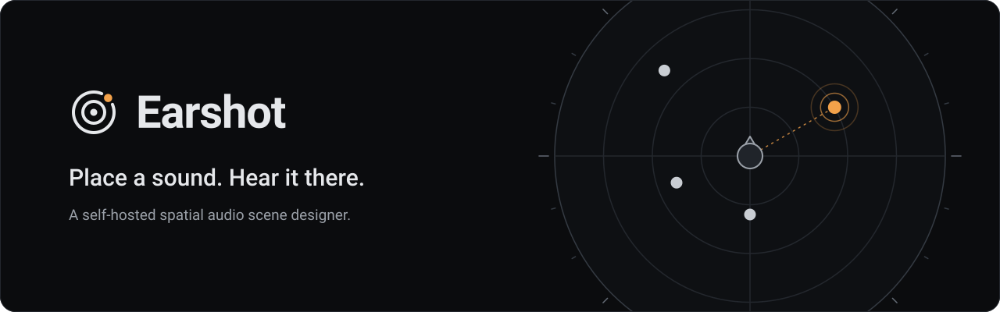
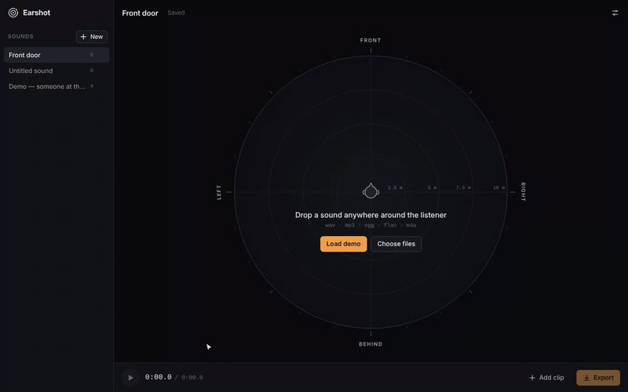
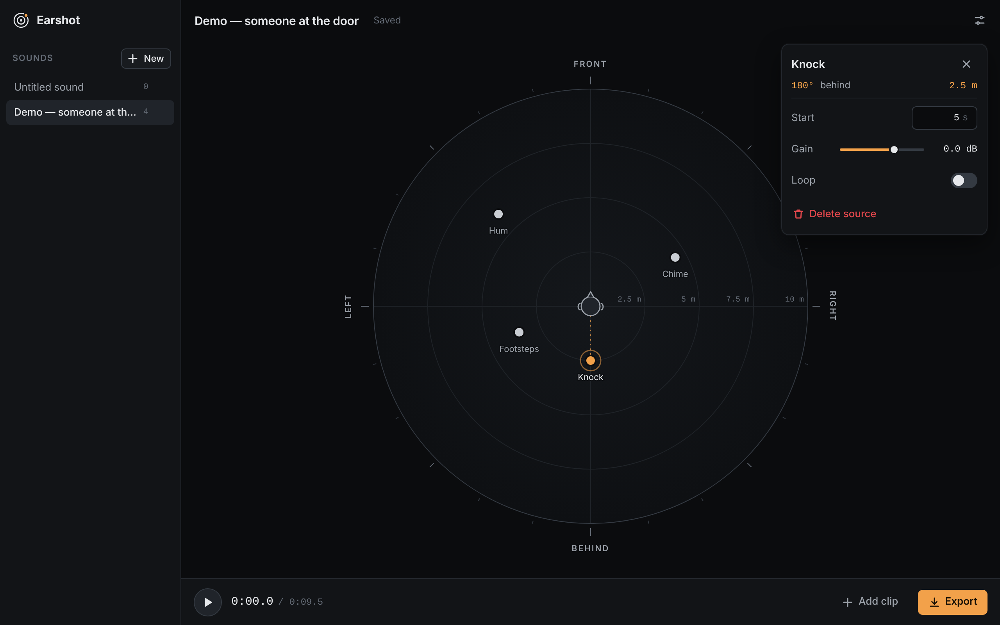
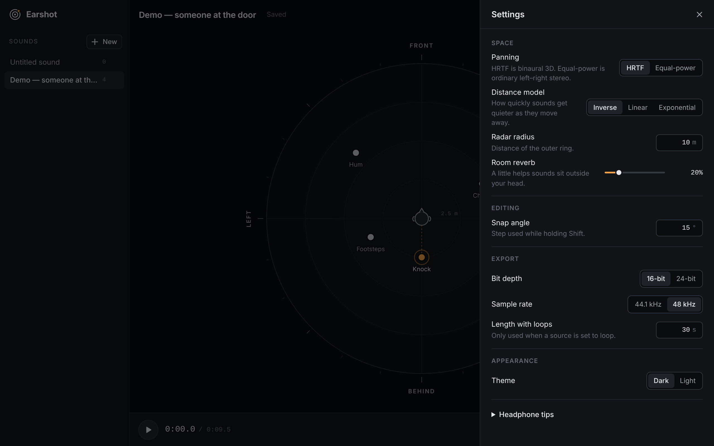
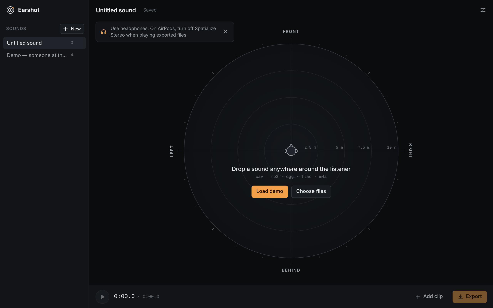
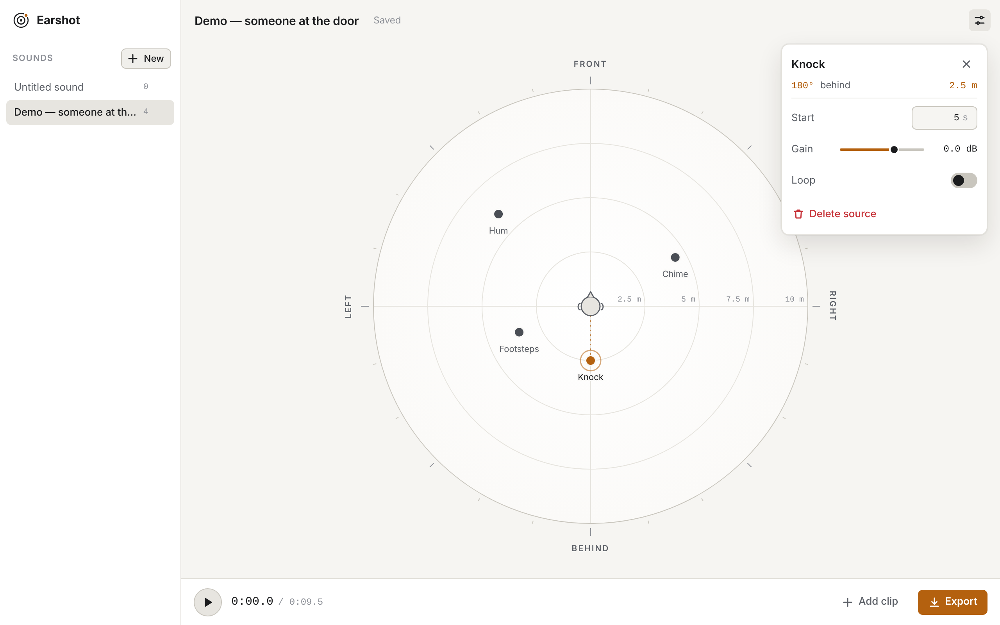

<p align="center">
  
</p>

<p align="center">
  <a href="https://github.com/joecrockett5/earshot/actions/workflows/ci.yml"></a>
  <a href="https://github.com/joecrockett5/earshot/releases/latest"></a>
  <a href="https://github.com/joecrockett5/earshot/pkgs/container/earshot"></a>
  <a href="LICENSE"></a>
</p>

**Earshot is a self-hosted spatial audio scene designer: drop sounds around a listener on a radar, hear them there on headphones, and export the result as a binaural WAV.**

<p align="center">
  
</p>

## Features

- **A radar, not a mixer.** The listener sits in the centre facing up. Up is in front, down is behind. Where you drop a sound is where you hear it.
- **Drag in audio files** (WAV, MP3, OGG, FLAC, M4A) straight from your desktop. Drag dots to move them; hold <kbd>Shift</kbd> to snap the angle.
- **Live binaural preview** using the HRTF panner built into your browser. Dots pulse while they sound.
- **Per-source controls**: label, start time, gain and loop.
- **Export to stereo WAV** (16- or 24-bit, 44.1 or 48 kHz) that plays on any headphones, in any player.
- **Distance that sounds like distance**: level roll-off, a gentle high-frequency loss, and an optional touch of room reverb.
- **Saved on your server.** Scenes are plain JSON and clips are plain files in one folder. No database, no account, no cloud.
- **Keyboard friendly**: <kbd>Space</kbd> plays and stops, <kbd>Delete</kbd> removes, arrows nudge, <kbd>Ctrl</kbd>/<kbd>⌘</kbd>+<kbd>E</kbd> exports.
- **One small container**, for amd64 and arm64.

## Quick start

Save this as `docker-compose.yml`:

```yaml
services:
  earshot:
    image: ghcr.io/joecrockett5/earshot:0
    container_name: earshot
    ports:
      - '8080:8080'
    volumes:
      - ./data:/data
    restart: unless-stopped
```

Then start it:

```bash
docker compose up -d
```

Open <http://localhost:8080>, put your headphones on, and press **Load demo**.

Everything you make is stored in `./data` next to the compose file. Back up that folder and you have backed up Earshot. The same file lives in this repository as [`compose.yaml`](compose.yaml).

> [!IMPORTANT]
> **Earshot has no login, by design.** Anyone who can reach the port can read, change and delete everything in it. Run it on your home network, over a private network such as Tailscale, or behind a reverse proxy that adds authentication. Do not expose it directly to the internet. See [SECURITY.md](SECURITY.md).

## Screenshots

|                                                                                |                                                 |
| ------------------------------------------------------------------------------ | ----------------------------------------------- |
|  |  |
| The demo scene, with the knock behind the listener selected                    | Settings stay out of the way behind one button  |
|                               |   |
| A new Sound                                                                    | Light theme                                     |

## Configuration

Earshot is configured with environment variables. The defaults suit the compose file above.

| Variable        | Default | Description                                                                                 |
| --------------- | ------- | ------------------------------------------------------------------------------------------- |
| `PORT`          | `8080`  | Port the server listens on inside the container.                                            |
| `DATA_DIR`      | `/data` | Where scenes (`scenes/<id>.json`) and audio clips (`clips/<id>.<ext>`) are stored.          |
| `MAX_UPLOAD_MB` | `50`    | Largest audio file that can be uploaded, in megabytes.                                      |
| `LOG_LEVEL`     | `info`  | `fatal`, `error`, `warn`, `info`, `debug`, `trace` or `silent`. `debug` logs every request. |

Settings that shape the sound (panning model, distance model, radar radius, reverb, export format, snap angle) are in the app, behind the settings button, and are saved with each Sound.

The container runs as an unprivileged user (uid 1000). To run it as a different user, add `user: "UID:GID"` to the compose service and make sure that user can write to `./data`.

## How it works

You locate sounds using three clues: a sound to your right reaches your right ear **sooner**, it is **louder** there, and the shape of your head and outer ears **colours** it differently depending on where it comes from. Measure those effects for many directions and you have a _head-related transfer function_, or HRTF. Run a mono sound through the HRTF for a direction, play the result on headphones, and your brain is handed the same clues it would get from a real sound in that place. That is binaural audio.

Earshot uses the HRTF built into your browser's Web Audio engine:

1. Each dot on the radar becomes a Web Audio [`PannerNode`](https://developer.mozilla.org/en-US/docs/Web/API/PannerNode) in HRTF mode. The listener sits at the origin facing "up" the radar; the outer ring is 10 m away unless you change it.
2. Distance makes a sound quieter (the panner's distance model) and slightly duller (a low-pass filter per source), the way air and walls do.
3. A small amount of synthetic room reverb is mixed in. Completely dry binaural audio tends to sound as if it is inside your head; a little room pushes it out.
4. **Play** runs that graph live. **Export** rebuilds the identical graph in an offline context, renders it faster than real time, and encodes a WAV, all in your browser. The server only stores your files.

Because the spatial cues are baked into an ordinary stereo file, the export needs no special player.

## Headphone notes and honest limitations

- **You need headphones, and both of them.** The effect is made of differences between your two ears. Speakers let each ear hear both channels, which destroys it.
- **Turn off other spatial processing.** On AirPods, switch off _Spatialize Stereo_ and head tracking when playing exported files. On other systems, disable "surround", "3D audio" or Dolby virtualisers. Otherwise the audio is spatialised twice.
- **Front and behind are easily confused.** The HRTF in your browser was measured on one generic head, not yours. Left and right are very reliable; front versus behind, and up versus down, are much less so. In real life you resolve this by moving your head a little, and a fixed recording cannot respond to that.
- **Sharp, full-range sounds work best.** Knocks, clicks, footsteps, speech and keys are easy to place. Hums, bass and pure tones are hard to place in real life too.
- **There is no height.** Sources sit on a flat plane at ear level.
- **Preview and export can differ slightly between browsers**, because each browser ships its own HRTF data.

## Roadmap

Deliberately out of scope for the first version, roughly in order of interest:

- Moving sources along paths over time
- Head tracking during preview
- Custom HRTFs (SOFA files)
- Multichannel and Atmos export
- User accounts and permissions

## Development

You need Node.js 24 (see `.nvmrc`; 22 also works) and npm.

```bash
git clone https://github.com/joecrockett5/earshot.git
```

```bash
cd earshot
```

```bash
npm install
```

```bash
npm run dev
```

`npm run dev` starts the API on port 8080 and the web app with hot reload on <http://localhost:5173>, storing data in `./data`.

| Command                | What it does                                                         |
| ---------------------- | -------------------------------------------------------------------- |
| `npm run lint`         | ESLint                                                               |
| `npm run format`       | Format everything with Prettier                                      |
| `npm run typecheck`    | `tsc --noEmit` across every workspace                                |
| `npm test`             | Unit tests (Vitest)                                                  |
| `npm run e2e`          | Builds, then runs the Playwright end-to-end and spatialisation tests |
| `npm run build`        | Build the web app and bundle the server                              |
| `npm start`            | Run the built server                                                 |
| `npm run docker:smoke` | Build the image, run it, and exercise it over HTTP                   |
| `npm run demo:sounds`  | Re-synthesise the demo clips                                         |
| `npm run brand`        | Regenerate logo, favicon, banner and social preview                  |
| `npm run media`        | Regenerate the README screenshots and GIF (needs ffmpeg)             |

The first time you run the end-to-end tests, install the browser with `npx playwright install chromium`.

The repository is an npm workspace:

```text
apps/web          React + TypeScript + Vite front end (radar, audio engine, export)
apps/server       Fastify server: REST API and static files
packages/shared   Scene schema, coordinate maths, acoustics helpers, WAV codec
```

Design decisions and their reasons are recorded in [docs/DECISIONS.md](docs/DECISIONS.md); the visual identity is in [docs/BRAND.md](docs/BRAND.md).

## Contributing

Bug reports, ideas and pull requests are welcome. Please read [CONTRIBUTING.md](CONTRIBUTING.md) first, and the [Code of Conduct](CODE_OF_CONDUCT.md). Security problems should be reported privately as described in [SECURITY.md](SECURITY.md).

## Licence

[MIT](LICENSE) © Joe Crockett
